<div align="center">

# Narrivy

**Your private AI voice and writing suite.**
Voice typing in any app, meeting transcripts with speakers and notes, a local AI assistant
with web research, and grammar checks and rewriting in your browser.
Runs 100% on your device on CPU, GPU or NPU. Linux today; Windows next, macOS later.

[](LICENSE)
-informational)


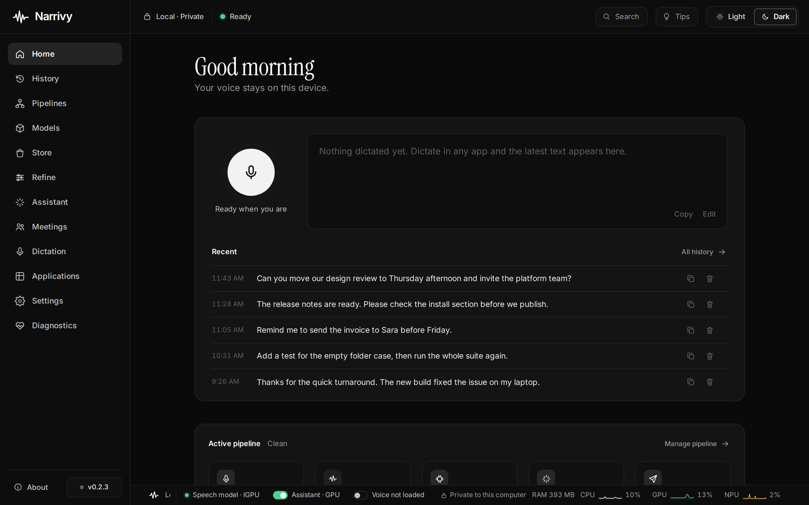

</div>

## What is Narrivy?

Narrivy is an open-source suite of **private AI tools for speaking and
writing** that runs entirely on your own computer. Press a shortcut and talk,
and the text appears in whatever app has focus. Record a meeting and get a
transcript with notes. Ask the assistant, or let it research the web. Write
in your browser with grammar checks and AI rewriting. No cloud, no account.

| | |
|---|---|
| 🎙️ **Voice typing anywhere** | One shortcut, any app, toggle or press-and-hold |
| 🔒 **Private by design** | Speech recognition and AI run locally; no account, no telemetry |
| ⚡ **Fast on modern laptops** | Uses the NPU, GPU or CPU, whichever is best |
| 🧑‍🤝‍🧑 **Meetings** | Transcripts with each speaker kept apart, plus notes |
| 🤖 **Local assistant** | Chat, research the web (when you allow it), work with files |
| ✍️ **Writing assistant** | Grammar, spelling and AI rewriting in Chrome and Brave |
| 🌍 **Many languages** | Whisper models: English, Urdu and about 100 more |

## Features

### Dictation that types for you

Speak, and Narrivy types the text into the focused window. Live words show in a
small overlay while you talk, then a clean-up model fixes filler words,
punctuation and capitals before the text is typed.

<p align="center">
  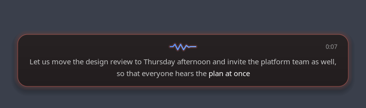
  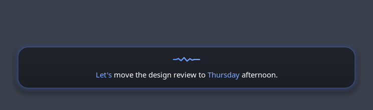
</p>

- **Clean** or **Raw** text, your own words and replacements, numbers as digits
- **Only my voice**: trained on your voice, it ignores people talking nearby
- **Echo cancellation**: a video or call playing on your speakers isn't typed
- **Never lost**: if text can't be typed, it's kept in History to copy later

### Pipelines: your voice, your way

Each pipeline is a chain of stages: microphone, voice, transcribe, refine,
deliver. Give each one its own shortcut, model and options.

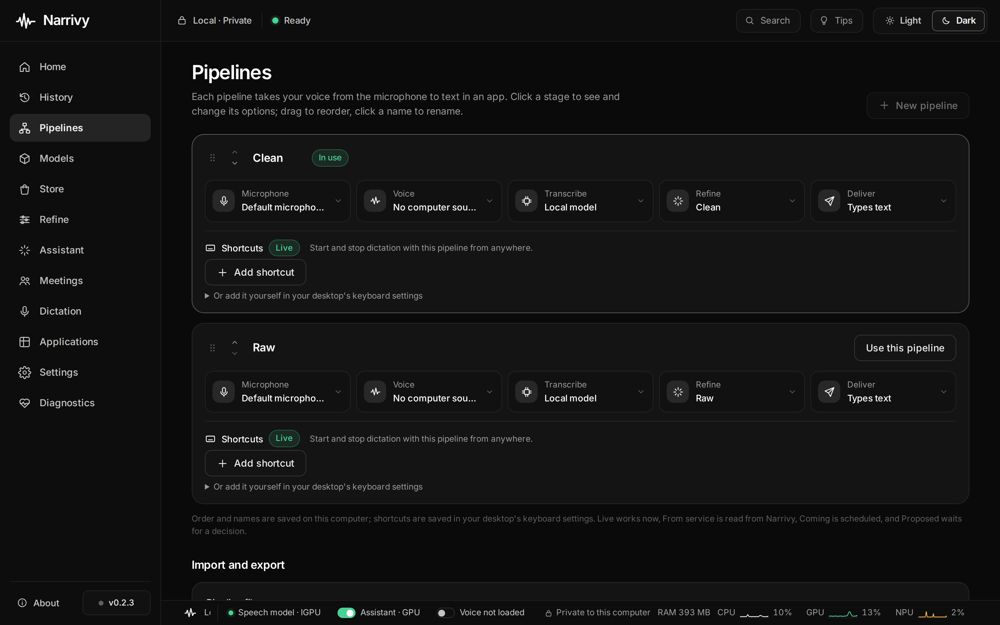

### Meetings with speakers and notes

Record a meeting or a call, or transcribe a file you already have. Narrivy
tells the speakers apart, lets you name them, and writes notes, action items or
a follow-up email with the local model.

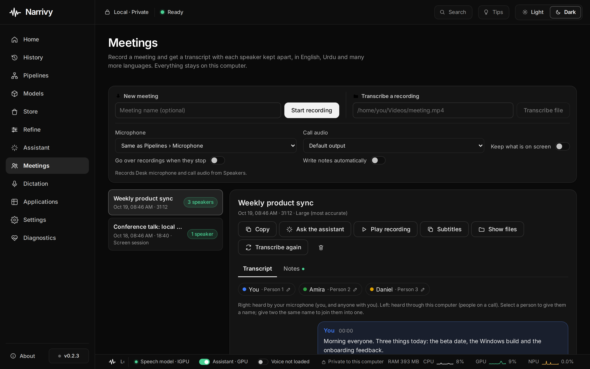

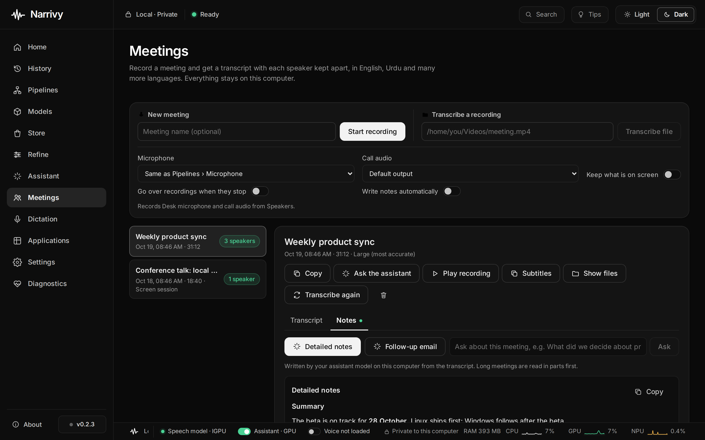

- Live transcript while you record
- Subtitles (`.srt`, `.vtt`) with each person's name
- Keep what's on screen, described by the assistant
- Ask questions about any meeting

### A local AI assistant

A chat assistant that runs on your machine. Turn on **Web** to let it search and
read pages, or **Computer** to let it work with files in a folder you choose.
Every step it takes is shown in the Activity panel.

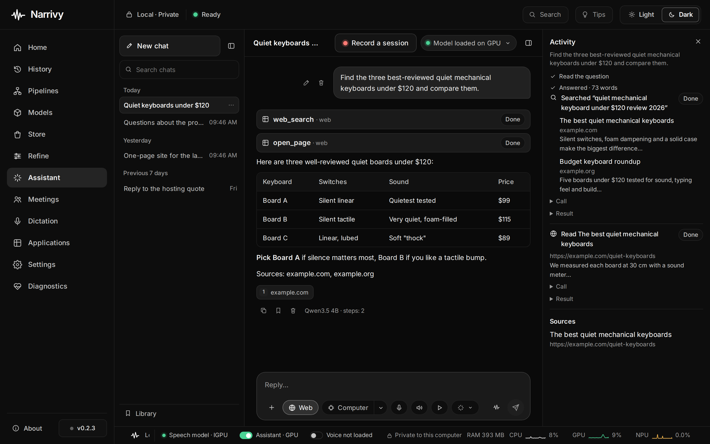

- Voice mode: talk to it and hear the answer
- Share your screen live, or record a session and ask about it later
- Tools from MCP servers, each call approved first
- Thinking levels per chat

### Writing assistant in your browser

Grammar, spelling and punctuation checks as you type in Chrome and Brave, with
one-click fixes, plus AI actions to fix, improve or rewrite a selection.
Checks and rewrites run on your computer through Narrivy; the extension
itself has no network access, and it stays off on password and payment fields.

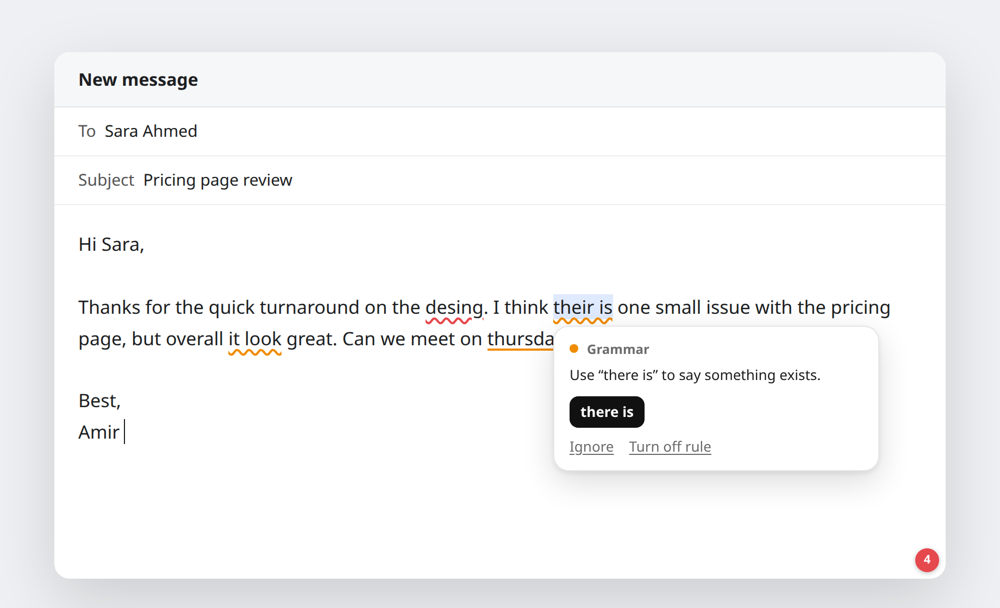

### Models and the Store

Pick a speech model that fits your computer. Optional packs add hardware
acceleration (Intel NPU and GPU through OpenVINO) and extras such as the
assistant's own browser. Downloads are checked against published checksums.

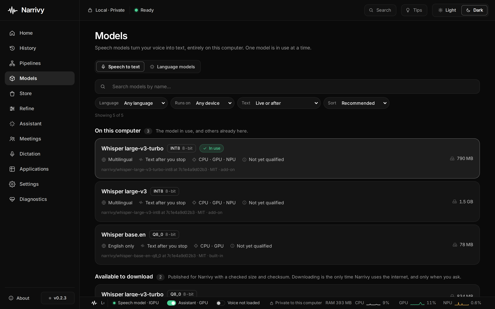

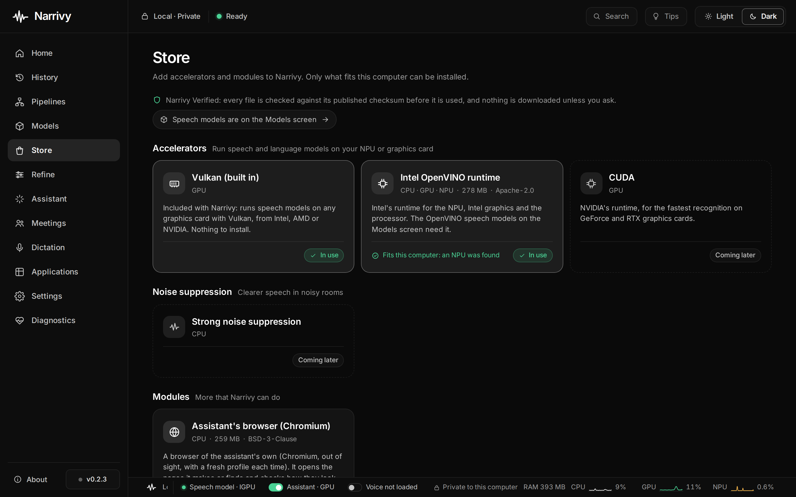

### History

Every dictation, with how long it took to transcribe. Keep it for 7 days, 30
days, forever, or not at all.

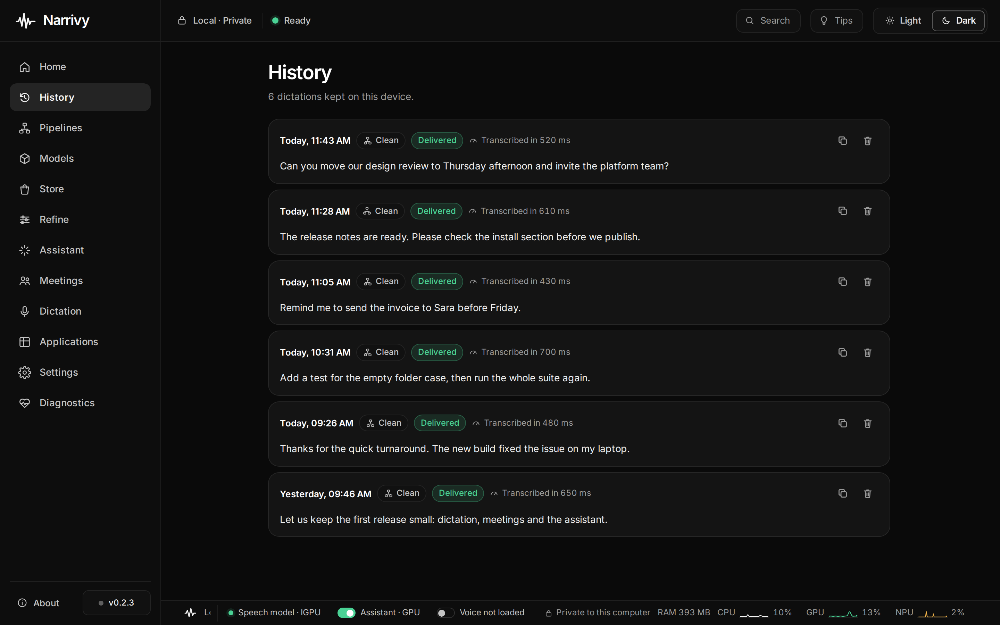

## Platforms and hardware

| | Now | Coming |
|---|---|---|
| **Operating systems** | Linux (Pop!_OS 24.04, COSMIC, Wayland) | Windows (in development), other Linux desktops, macOS later |
| **GPU** | Intel, AMD and NVIDIA through Vulkan | NVIDIA CUDA pack |
| **NPU** | Intel Core Ultra through OpenVINO | AMD Ryzen AI |
| **CPU** | Any modern x86-64 | |
| **Browsers** (writing assistant) | Chrome, Brave | Firefox |

## Install

> **Narrivy is pre-release.** The first beta, a `.deb` for **Pop!_OS 24.04 with
> the COSMIC desktop (Wayland)**, is in preparation. Windows support is in
> progress. Watch the repository to hear when it's out.

Until then you can [build it from source](#build-from-source).

## FAQ

### Does Narrivy work offline?
Yes. Speech recognition, clean-up and the assistant all run on your computer.
The internet is used only when you download a model or turn on web research in
a chat.

### Is my voice sent to the cloud?
No. Audio and text stay on your computer. Narrivy has no account, no telemetry,
and its logs never contain what you said.

### Is Narrivy free?
Yes. It's open source under the [MIT licence](LICENSE).

### What hardware do I need?
Any recent x86-64 PC works on the CPU. A GPU (Intel, AMD or NVIDIA, through
Vulkan) or an Intel NPU (Core Ultra, through the optional OpenVINO pack) makes
it much faster and lighter on the battery.

### Is it a Grammarly alternative?
For writing in the browser, yes: the writing assistant checks grammar,
spelling and punctuation and can rewrite text, all on your computer instead of
a cloud service.

### Which languages does it understand?
The Whisper models understand about 100 languages, including English and Urdu.
English-only models are smaller and faster.

### Which Linux desktops are supported?
The first release targets Pop!_OS 24.04 with COSMIC on Wayland, including
XWayland apps. Ubuntu with GNOME and other desktops come next.

### Is there a Windows or macOS version?
Windows is in development and comes next. macOS is planned for later.

### How is it different from cloud dictation and writing apps?
Cloud apps send your voice and your writing to a server. Narrivy does all the
work on your machine, so it works without an internet connection and nothing
you say or write is stored anywhere else.

## Build from source

Narrivy is a Rust workspace with a [Tauri](https://tauri.app) desktop app and a
React UI.

```bash
scripts/bootstrap-linux-dev.sh --install   # system packages
(cd apps/narrivy-desktop && npm ci && npm run build)
cargo build --locked
```

Run the service and the app in development:

```bash
scripts/dev-daemon.sh
```

More in [docs/](docs/README.md) and [scripts/README.md](scripts/README.md).

## How it works

```text
shortcut ─▶ narrivyd (your user's service)
             ├─ microphone (PipeWire, echo cancellation, voice filter)
             ├─ speech model (Whisper on NPU, GPU or CPU)
             ├─ clean-up model (small local language model)
             └─ types the text into the focused app, or keeps it in History
desktop app ◀─▶ narrivyd over a private, same-user socket
```

Architecture: [docs/architecture/](docs/architecture/README.md) ·
Decisions: [docs/adr/](docs/adr/) · Roadmap: [docs/roadmap/](docs/roadmap/README.md)

## Contributing

Issues and pull requests are welcome. See [CONTRIBUTING.md](CONTRIBUTING.md).
Report security problems privately: [SECURITY.md](SECURITY.md).

## Licence

[MIT](LICENSE). Third-party components: [THIRD_PARTY_NOTICES.md](THIRD_PARTY_NOTICES.md).

<sub>Narrivy: open-source, private AI for voice typing, speech to text, meeting transcription and notes, a local AI assistant and an in-browser grammar and writing assistant. Runs offline on CPU, GPU and NPU; Linux first, Windows and macOS to follow.</sub>
