# Narrivy

Narrivy is a free, open-source desktop app for **offline voice typing and
speech-to-text** on Linux and Windows. Press a shortcut, speak, and the text
is typed into whichever app has focus. It also records meetings, runs a local
AI assistant and checks grammar in the browser. Speech recognition and
language models run on your own NPU, GPU or CPU; nothing you say is sent to a
server.

[](https://github.com/iamwaqargulzar/Narrivy/releases/latest)
[](LICENSE)

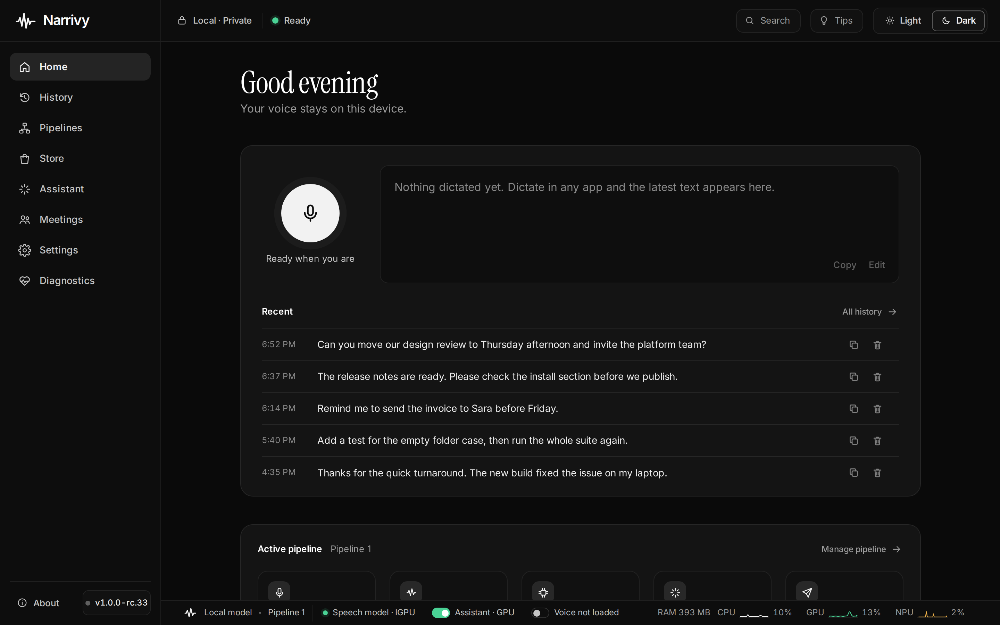

## Contents

- [Install](#install)
- [Features](#features)
- [Supported systems and hardware](#supported-systems-and-hardware)
- [Privacy](#privacy)
- [FAQ](#faq)
- [Building from source](#building-from-source)
- [Architecture](#architecture)
- [Contributing](#contributing)

## Install

Download the package for your system from the
[latest release](https://github.com/iamwaqargulzar/Narrivy/releases/latest).
The current version is 1.0.0-rc.33, a release candidate.

**Linux** (Pop!_OS 24.04, COSMIC desktop, Wayland):

```bash
sudo apt install ./narrivy_1.0.0-rc.33_amd64.deb
```

The package installs a per-user service and an entry in the app launcher.
Other Ubuntu 24.04-based systems may work but are not tested for this release.

**Windows** (Windows 11, 64-bit): run `Narrivy_1.0.0-rc.33_x64_en-US.msi`.
The installer is not code-signed yet, so SmartScreen may show a warning;
choose **More info**, then **Run anyway**.

Neither package includes a speech model. On first run Narrivy suggests models
that suit your hardware and downloads the one you choose, verifying it
against its published SHA-256 checksum.

To update, install the newer package over the old one. Settings, history and
downloaded models are kept.

## Features

### Voice typing in any app

Dictation works system-wide: in a browser, an editor, a terminal or a chat
app. A small overlay shows the words as you speak. When you stop, an optional
local language model removes filler words and fixes punctuation and
capitalisation, then Narrivy types the result.

<p align="center">
  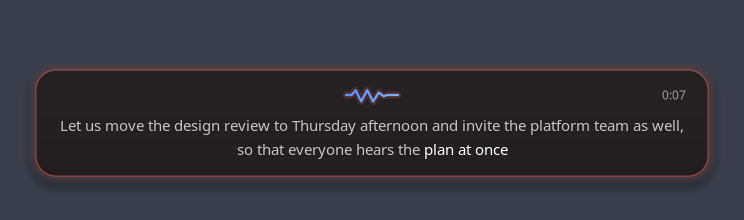
  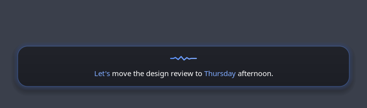
</p>

- Toggle or push-to-talk shortcuts
- Clean or raw output, a personal vocabulary and replacement rules
- Echo cancellation, so audio playing from your speakers is not transcribed
- Noise suppression and automatic gain
- A dictation with no speech produces no text
- If text cannot be typed into the target app, it is kept in History

### Pipelines

A pipeline is a chain of five stages: capture, voice processing,
transcription, refinement and delivery. Each pipeline has its own shortcut,
speech model and options, so you can keep, for example, a fast English
pipeline and a multilingual one side by side.

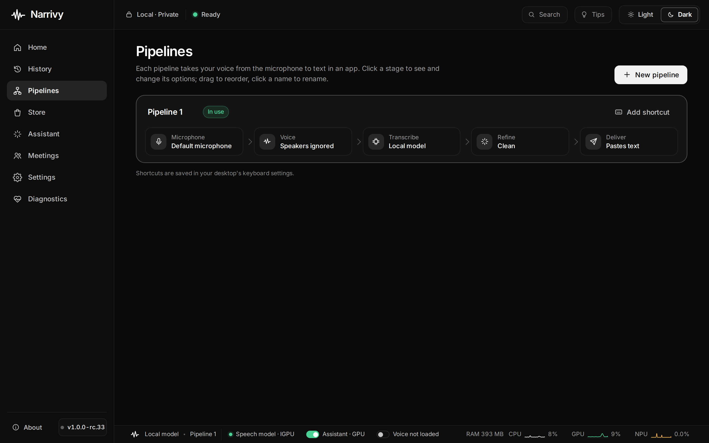

### Meetings

Narrivy records a meeting or call from the microphone together with the sound
your computer plays, or imports an existing recording. Speakers can be named,
and the local language model can write a summary, action items or a
follow-up email.

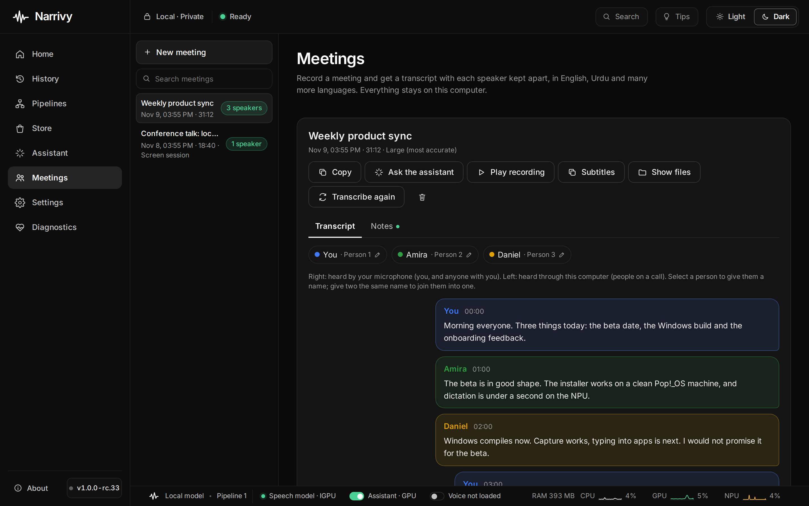

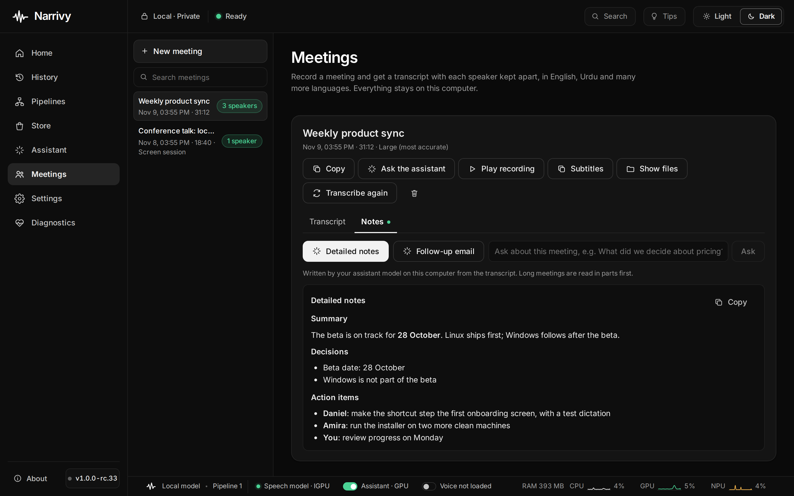

> In 1.0.0-rc.33 the packages record meetings but do not transcribe them yet.
> Transcription needs the meeting add-on (speech and speaker models), which
> will ship separately.

### Local AI assistant

A chat assistant that runs on your machine. With **Web** enabled it can search
and read pages; with **Computer** enabled it can work with files in a folder
you choose. Each step is listed in an activity panel, and tools from MCP
servers need your approval before they run. Voice mode lets you talk to the
assistant and hear its replies.

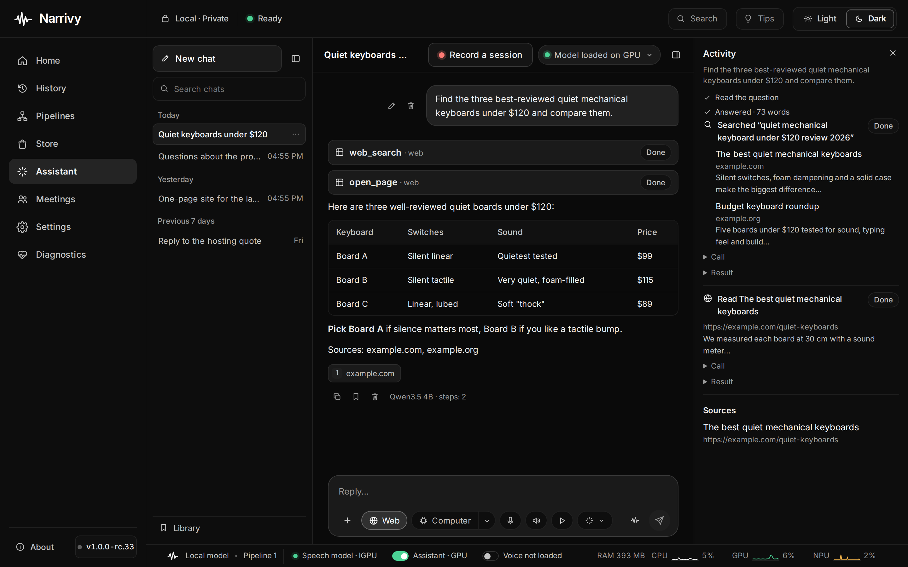

### Writing assistant for Chrome and Brave

A browser extension checks grammar, spelling and punctuation as you type and
offers to fix, improve or rewrite a selection. The checks run in Narrivy on
your computer; the extension itself has no network access and is disabled on
password and payment fields.

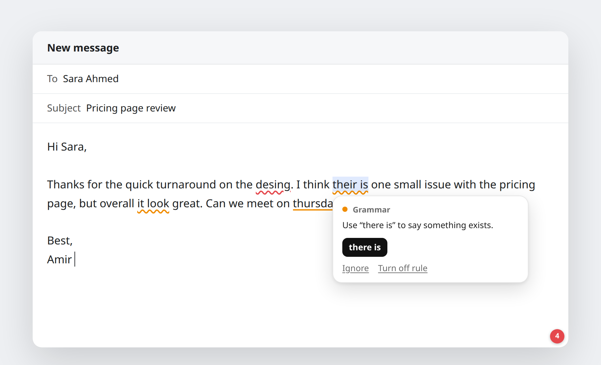

### Models and add-ons

Speech models include Whisper (about 100 languages, including English and
Urdu) and Parakeet, in several sizes. Optional add-ons provide Intel NPU and
GPU acceleration through OpenVINO, noise suppression and other modules. Every
download is verified against its published checksum.

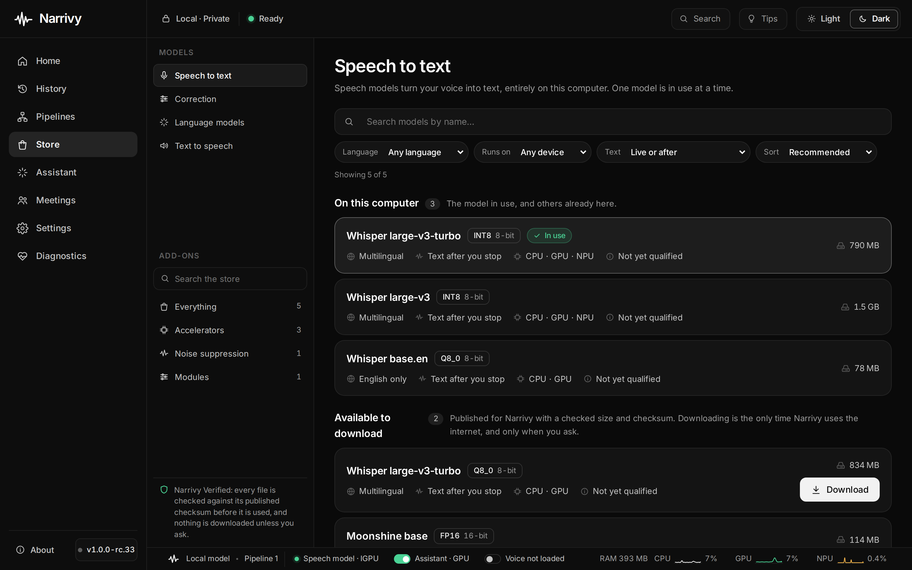

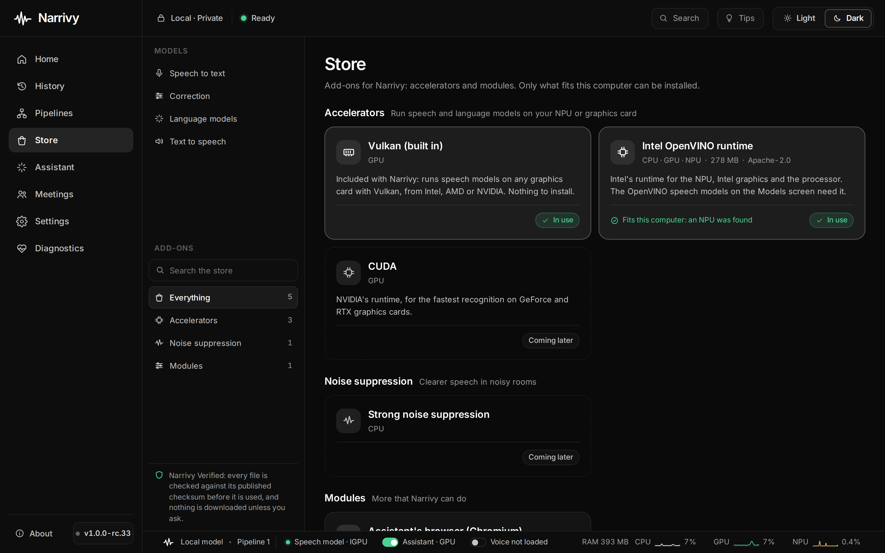

### History

Each dictation is listed with its transcription time. History can be kept for
7 days, 30 days, indefinitely, or switched off.

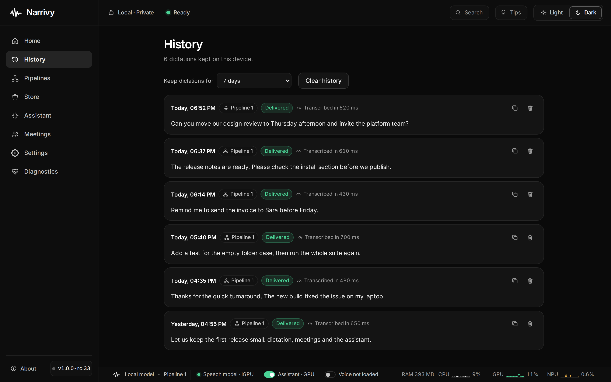

## Supported systems and hardware

| | Supported in 1.0.0-rc.33 | Planned |
|---|---|---|
| Operating system | Pop!_OS 24.04 (COSMIC, Wayland); Windows 11, 64-bit | Ubuntu GNOME, KDE Plasma and other Linux desktops; macOS |
| NPU | Intel Core Ultra, through the OpenVINO add-on | AMD Ryzen AI |
| GPU | Intel, AMD and NVIDIA, through Vulkan | NVIDIA CUDA add-on |
| CPU | Any modern x86-64 processor | |
| Browser (writing assistant) | Chrome, Brave | Firefox |

## Privacy

- Audio, transcripts and documents are processed on your computer.
- There is no account and no telemetry.
- Logs never contain transcript text, audio, clipboard contents or secrets.
- Narrivy connects to the internet only to download a model or add-on you
  ask for, or when you enable web research in an assistant chat.
- The desktop app talks to the Narrivy service over a local connection that
  only your user account can open.

Security issues can be reported privately; see [SECURITY.md](SECURITY.md).

## FAQ

**Does Narrivy work offline?**
Yes. Speech recognition, text clean-up and the assistant run locally. An
internet connection is needed only to download models and add-ons, or for
web research when you turn it on.

**Is Narrivy free?**
Yes. It is open source under the MIT licence.

**How is it different from cloud dictation services?**
Cloud dictation sends your audio to a remote server for recognition. Narrivy
runs the speech model on your own hardware, so it works without a connection
and your audio never leaves the computer.

**Can it use an Intel NPU?**
Yes. On Intel Core Ultra processors the OpenVINO add-on runs Whisper models on
the NPU, which leaves the CPU and GPU free and uses less power. Without it,
Narrivy uses the GPU through Vulkan, or the CPU.

**Which languages does it support?**
The multilingual Whisper models recognise about 100 languages, including
English and Urdu. English-only models are smaller and faster.

**Does it work on Wayland?**
Yes. The Linux release targets the COSMIC desktop on Wayland and also types
into XWayland apps.

**What hardware do I need?**
Any recent 64-bit PC can run the smaller models on the CPU. A GPU or an Intel
NPU makes the larger, more accurate models fast enough for everyday use.

**What is kept when I uninstall?**
Uninstalling removes the program but keeps your data, so a reinstall picks up
where you left off. To remove the data as well, delete these folders:

- Linux: `~/.local/share/narrivy`, `~/.config/narrivy`,
  `~/.local/state/narrivy` and `~/.cache/narrivy`
  (`sudo apt purge narrivy` also lists them)
- Windows: `%LOCALAPPDATA%\Narrivy` and `%LOCALAPPDATA%\app.narrivy.shell`

## Building from source

Narrivy is a Rust workspace with a [Tauri](https://tauri.app) desktop app and
a React interface. On Debian or Ubuntu:

```bash
scripts/bootstrap-linux-dev.sh --install
(cd apps/narrivy-desktop && npm ci && npm run build)
cargo build --locked
scripts/dev-daemon.sh
```

[scripts/README.md](scripts/README.md) covers Windows builds, packaging and
the checks CI runs.

## Architecture

```text
shortcut ─▶ narrivyd (per-user service)
             ├─ audio capture: echo cancellation, noise suppression, voice filter
             ├─ speech recognition: Whisper or Parakeet on NPU, GPU or CPU
             ├─ refinement: a small local language model
             └─ delivery: types into the focused app, or keeps the text in History
desktop app ◀─▶ narrivyd over a same-user local connection
```

The core crates are platform-independent; Linux and Windows behaviour lives
in separate adapter crates. See the
[architecture overview](docs/architecture/README.md), the
[decision records](docs/adr/) and the [roadmap](docs/roadmap/README.md).

## Contributing

Bug reports, feature requests and pull requests are welcome. Please read
[CONTRIBUTING.md](CONTRIBUTING.md) and the
[engineering rules](docs/development/engineering-rules.md) first.

## Licence

Narrivy is released under the [MIT licence](LICENSE). Third-party components
and their licences are listed in [THIRD_PARTY_NOTICES.md](THIRD_PARTY_NOTICES.md).
